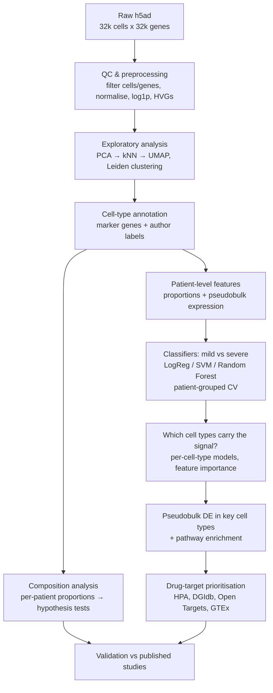

# Predicting COVID-19 Severity from Nasal Single-Cell Transcriptomes

**BT3041 – Analysis and Interpretation of Biological Data · IIT Madras · Term Project**

> Can the nasal swab taken at diagnosis tell us who will become severely ill? If so, which cell types carry that signal, and which genes in them could be drug targets?

---

## 1. Problem statement

COVID-19 ranges from mild illness to respiratory failure. The nasopharynx is the first place SARS-CoV-2 infects, and Ziegler et al. (2021) showed that patients who go on to severe disease have a weaker early antiviral (interferon) response in their nasal epithelium.

We ask whether that difference is strong enough to **classify a patient as mild or severe from their nasal single-cell transcriptome**. We then ask which **cell types** drive the prediction, and which **genes** in those cells are plausible **therapeutic targets**.

## 2. Objectives

| # | Objective | Output |
|---|---|---|
| O1 | Map the cell landscape of the nasal swab (epithelial + immune) | QC'd dataset, PCA/UMAP, clusters annotated by cell type |
| O2 | Test whether cell-type **composition** differs between control, mild and severe | Proportion plots, hypothesis tests with FDR correction |
| O3 | Build **patient-level classifiers** for mild vs severe COVID-19 | Cross-validated accuracy / AUROC, split by patient |
| O4 | Identify **which cell types carry the predictive signal** | Per-cell-type model performance, feature importance |
| O5 | Find **severity-associated genes**, their roles, and prioritise candidate **drug targets** | Pseudobulk DE, pathway enrichment, ranked target shortlist |
| O6 | **Perturbation analysis**: shift key genes in silico, measure the change in predicted severity | Effect of each key gene vs matched random genes |
| O7 | **Sensitivity analysis**: robustness to severity definition, features, QC, cells per patient | AUROC / top genes across settings |
| O8 | Check results against published work and independent data | Overlap with Ziegler et al. findings, external cohort |

O5–O7 were added after mentor feedback. scRNA-seq costs about $2,000 per sample, so the project should give more than a diagnosis. It should also point to biology that can be acted on.

## 3. Dataset

**Ziegler CGK et al., *Impaired local intrinsic immunity to SARS-CoV-2 infection in severe COVID-19*, Cell 184 (2021)**

| | |
|---|---|
| Sample | Nasopharyngeal swabs, Seq-Well S³ scRNA-seq |
| Donors | 58: 14 mild/moderate COVID-19 (WHO 1–5), 21 severe COVID-19 (WHO 6–8), 15 healthy controls, 6 non-COVID ICU respiratory-failure controls, 2 convalescent |
| Size | 32,588 cells × 31,738 genes (incl. 10 SARS-CoV-2 genes); raw counts in `.raw.X` |
| File | `.h5ad` (AnnData), 256 MB |

**Where to get it**
- CZ CELLxGENE (used here): https://cellxgene.cziscience.com/collections/35d0b748-3eed-43a5-a1c4-1dade5ec5ca0
  Direct link: `https://datasets.cellxgene.cziscience.com/6a6db93e-901f-4054-90e0-14af5207978a.h5ad`
- Broad Single Cell Portal: [SCP1289](https://singlecell.broadinstitute.org/single_cell/study/SCP1289) (sign-in required)
- Human Cell Atlas: [project 111d272b](https://explore.data.humancellatlas.org/projects/111d272b-c25a-49ac-9b25-e062b70d66e0)

**Supporting resources (drug-target step)**
- Human Protein Atlas: protein class, whether a gene is druggable or an approved drug target
- GTEx: expression across normal tissues (flags targets that may be unsafe to hit)
- DGIdb / Open Targets: known drug–gene interactions, COVID-19 association evidence
- MSigDB / Reactome / GO (via `gseapy`): pathway enrichment

**Key caveat:** we have 35 COVID-19 patients (14 vs 21), and some donors have very few cells (18 to 2,140 per donor). Each **patient**, not each cell, is one sample. All statistics and cross-validation are set up around this.

## 4. Workflow



### 4.1 Preprocessing
- QC: remove low-quality cells (few genes, high mitochondrial %) and genes detected in very few cells
- Library-size normalisation → `log1p` → select highly variable genes → scale

### 4.2 Exploratory analysis (preliminary results)
- **PCA:** variance explained, and whether the top PCs separate cell types, patients or severity
- **UMAP** on the PCA neighbour graph, coloured by cell type, severity and donor
- **Leiden / k-means clustering**, checked against the authors' annotations
- Marker-gene **dot plots / heatmaps**, and **violin plots** of key genes (e.g. interferon-stimulated genes, ACE2, TMPRSS2)

### 4.3 Hypothesis-driven analysis
- **Cell-type proportions:** computed per patient, then compared across control / mild / severe with Kruskal–Wallis and Mann–Whitney U tests. Proportions are compositional, so we also use a CLR transform.
- **Differential expression:** pseudobulk (sum counts per patient × cell type), then a DESeq2-style test. This avoids the inflated p-values you get from cell-level tests.
- **Multiple testing:** Benjamini–Hochberg FDR
- **Enrichment:** Fisher's exact test (over-representation) and GSEA on ranked gene lists

### 4.4 Classification
- **Task:** mild vs severe (primary); COVID-19 vs control (sanity check)
- **Features per patient:**
  1. cell-type proportions
  2. pseudobulk expression of HVGs/PCs within each cell type
- **Models:** logistic regression (L1/L2), SVM, random forest
- **Validation:** repeated stratified 5-fold over patients (primary) and leave-one-patient-out. Cells from the same patient never appear in both train and test.
- **Metrics:** AUROC, balanced accuracy, confusion matrix; permutation test for significance
- **Which cell types matter:** train one model per cell type and compare AUROC; use feature importance / SHAP for the full model

### 4.5 Drug-target prioritisation
Start from genes that are both DE between mild and severe **and** important to the classifier in the key cell types. Then rank them by:
- Druggability (HPA protein class, DGIdb categories)
- Existing drugs / clinical compounds (DGIdb, Open Targets)
- Prior COVID-19 evidence (Open Targets association score)
- Safety: expression across normal tissues (GTEx)

The output is a short ranked list of candidate targets, with the reasoning for each.

### 4.6 Validation
- Compare cell types, interferon signatures and DE genes with Ziegler et al. 2021
- If time permits: test the severity signature in an independent nasal cohort (Chua et al. 2020, moderate vs critical)

## 5. Tools

| Purpose | Library |
|---|---|
| scRNA-seq handling, PCA, UMAP, clustering | `scanpy`, `anndata`, `leidenalg` |
| Statistics | `scipy`, `statsmodels`, `pydeseq2` |
| ML | `scikit-learn`, `shap` |
| Enrichment | `gseapy` |
| Plots | `matplotlib`, `seaborn` |

Python 3.12; versions are pinned in `requirements.txt`:
```bash
pip install -r requirements.txt
```

## 6. Repository layout

```
data/
  raw/          # zeigler2021_nasal.h5ad (not in git; see "Getting the data")
  processed/    # QC'd object, patient tables, pseudobulk (gitignored; rebuilt by scripts)
  external/     # DGIdb, HPA, gene sets (committed snapshots; see SOURCES.md)
scripts/        # numbered pipeline: 01_qc.py, 03_patient_features.py, 05_classify.py, ...
notebooks/      # exploration + figures (NN_<topic>.ipynb)
results/<workstream>/   # tables (.tsv) + figures/
logs/           # one log per AI session + transcripts/ (course AI-usage supplement)
docs/literature/
```

### Getting the data

The raw scRNA-seq file is not in git (268 MB); download it before running the pipeline. The external resources in `data/external/` (DGIdb, HPA) are committed; their sources are in [data/external/SOURCES.md](data/external/SOURCES.md).

1. **Raw scRNA-seq** into `data/raw/`:
   ```bash
   curl -L -o data/raw/zeigler2021_nasal.h5ad https://datasets.cellxgene.cziscience.com/6a6db93e-901f-4054-90e0-14af5207978a.h5ad
   python -c "import hashlib;print(hashlib.md5(open('data/raw/zeigler2021_nasal.h5ad','rb').read()).hexdigest())"
   ```
   The md5 of the copy we used is `2fcf7a8a3a52ec91e824f2041679195f`. A different md5 means CELLxGENE has re-processed the file since.
2. Rebuild everything by running the numbered scripts in order from the repo root: `python scripts/01_qc.py`, `python scripts/02_embed_cluster.py`, …

## 7. Timeline

| Milestone | Date |
|---|---|
| Sprint: QC, UMAP, composition, first patient-level classifiers | Sat 31 Oct – Sun 1 Nov 2026 |
| Presentation deck submitted | Mon 2 Nov 2026, 1:00 PM IST |
| Presentation (6 min; ≥ 40% of methods + results done) | 3–6 Nov 2026 |
| Cell-type attribution, DE, enrichment, key genes | 10–14 Nov 2026 |
| Perturbation, sensitivity, drug targets, validation | 16–20 Nov 2026 |
| Final report (8 pages) + code + AI logs | 25 Nov 2026 |

## 8. Open questions for the mentor

- With 35 patients, is grouped CV enough, or should we also test on an external cohort?
- Mild vs severe only, or also model the full control → mild → severe ordering?
- Should drug-target prioritisation focus on epithelial cells, immune cells, or both?

## References

1. Ziegler CGK et al. Impaired local intrinsic immunity to SARS-CoV-2 infection in severe COVID-19. *Cell* 184, 4713–4733 (2021).
2. Chua RL et al. COVID-19 severity correlates with airway epithelium–immune cell interactions identified by single-cell analysis. *Nat Biotechnol* 38, 970–979 (2020).
3. Wolf FA et al. SCANPY: large-scale single-cell gene expression data analysis. *Genome Biol* 19, 15 (2018).
4. Squair JW et al. Confronting false discoveries in single-cell differential expression. *Nat Commun* 12, 5692 (2021).
